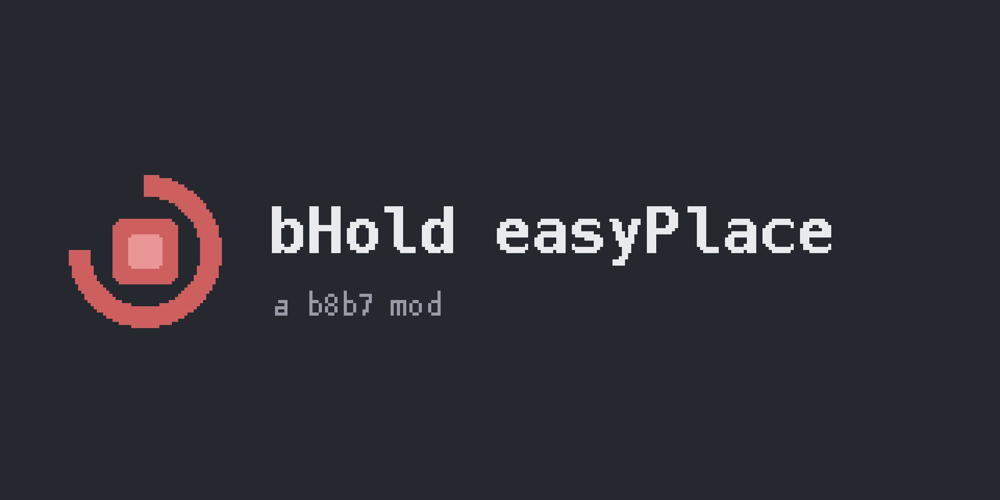

# bHold easyPlace

Download on [Modrinth](https://modrinth.com/mod/bhold-easy-place) or
from [GitHub releases](https://github.com/b8b7lives/bholdeasyplace/releases).

A [Litematica](https://modrinth.com/mod/litematica) addon for Fabric that
keeps Easy Place running every client tick, so you don't have to hold the
use key while building from a schematic. It also makes Easy Place
work with server custom items such as infinite blocks.

This is a continuation of
[Hold-Easy-Place](https://github.com/shane04111/Hold-Easy-Place) by
[shane0411](https://github.com/shane04111) (MIT). The last upstream
release (v0.1.8) supports Minecraft 1.21.x. bHold easyPlace brings the
same idea to Minecraft 26.x, rewritten against current Litematica and
malilib internals.

## What it does

- Adds a **Hold Easy Place Mode** toggle to Litematica's Generic config
  tab and a **Toggle Hold Easy Place** hotkey to the Hotkeys tab. Both
  persist in `litematica.json` via Litematica's own config handler.
- While enabled (and Litematica's `easyPlaceMode` is on), Easy Place
  fires every client tick as if you were holding the use key.
- This is Litematica's own Easy Place, minus the held key. It is not
  a printer. Placement uses vanilla reach, needs the target block under
  your crosshair, and makes one placement attempt per tick. Nothing gets
  placed behind you or through walls.
- Stays inactive whenever Litematica should own the tick: in REBUILD
  tool mode, while a GUI is open, and while you physically hold the use
  key.
- Supports both Litematica code paths (legacy and
  `easyPlacePostRewrite`).
- Hold-mode placement failures are silent. Manual clicks keep stock
  Litematica messaging, so you still get feedback when you click.

## Server custom items (optional)

Some servers hand out custom items such as infinite blocks. Stock Easy
Place refuses to place from them because the item data does not match
the schematic exactly. Four toggles in Litematica config > Generic
cover that:

- **Lenient Item Match**: a custom item counts as a match when the
  schematic wants the plain block. Items that need exact data, like
  filled shulkers, stay exact.
- **Skip Pick Block When Held**: leaves your hotbar alone when what you
  already hold satisfies the target.
- **Protect Custom Items**: pick block never moves another item into a
  slot holding a custom item.
- **Custom Item Loss Watchdog**: warns with a timestamp when a custom
  item leaves your inventory and is not given back within two seconds,
  so a lost infinite block becomes a support ticket with evidence.

Running [EasyPlaceFix](https://modrinth.com/mod/easyplacefix-fork) as well? On multiplayer it handles placement with
its own settings, so also enable its `nbtIgnore` and `loosenMode`
options for custom items there.

## Requirements

- Minecraft 26.2, Fabric Loader >= 0.19.0
- [Fabric API](https://modrinth.com/mod/fabric-api)
- [malilib](https://modrinth.com/mod/malilib)
- [Litematica](https://modrinth.com/mod/litematica)

Client-side only. Remove the original Hold-Easy-Place jar if you still
have it. This mod declares a conflict with it (`breaks`), because both
mods would drive Easy Place on the same tick.

## Usage

1. Enable Easy Place mode in Litematica as usual (`easyPlaceMode`).
2. Enable **Hold Easy Place Mode** in Litematica config > Generic, or
   bind **Toggle Hold Easy Place** in the Hotkeys tab.
3. Blocks place while you look at the schematic, with no key held.

## Differences from the original

Upstream's fail-tip config options, `cacheTime`, and the
schematics-folder button were intentionally dropped. The core behavior
of placing blocks without holding the key is unchanged.

## Building from source

```
./gradlew build
```

26.x mods are unobfuscated, so the build compiles directly against local
jars in `libs/` with no remapping. Drop these two files in `libs/`
first:

- `litematica-fabric-26.2-0.28.4.jar` from [Litematica on Modrinth](https://modrinth.com/mod/litematica)
- `malilib-fabric-26.2-0.29.3.jar` from [malilib on Modrinth](https://modrinth.com/mod/malilib)

When Litematica or malilib bump, update `libs/` and the two
`compileOnly` lines in `build.gradle`.

## Credits and license

- [shane0411](https://github.com/shane04111) wrote the original
  [Hold-Easy-Place](https://github.com/shane04111/Hold-Easy-Place),
  which this mod continues.
- [masa](https://modrinth.com/user/masa) wrote Litematica and malilib.

MIT, see [LICENSE](LICENSE). Copyright shane0411 (original) and b8b7
(26.x continuation).
